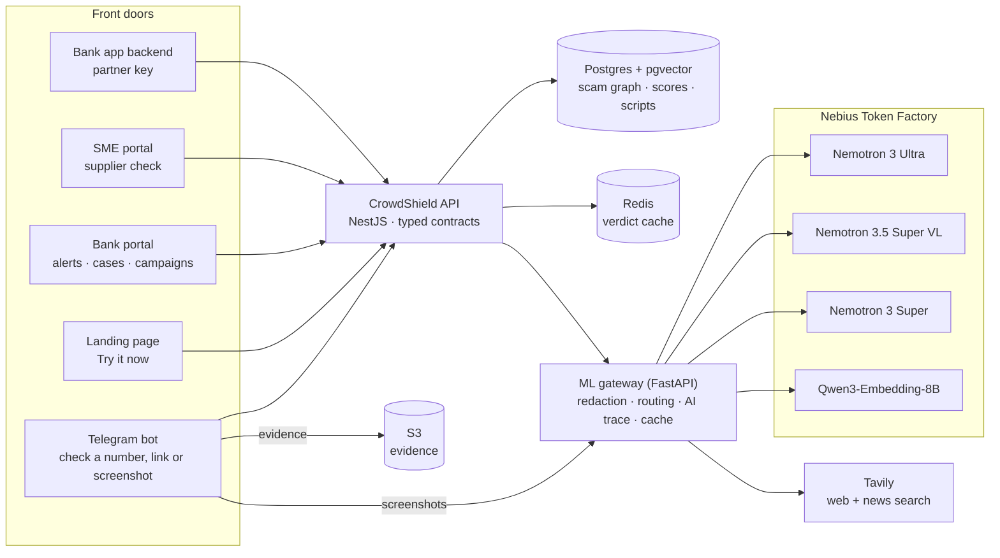

# CrowdShield

**Scam intelligence for Malaysia.** One shared scam graph that the public, banks, e-wallets and small businesses all feed and all use. The bank sees the transfer; the crowd saw the call. CrowdShield puts the two together before the money moves.

Built for the Nebius × NVIDIA Global AI Hackathon on **NVIDIA Nemotron** models served by **Nebius Token Factory**.

- **Live demo:** https://crowdshield.184-197-8-50.sslip.io (try a check on the landing page, no sign-in)
- **Telegram bot:** [@CrowdShieldBot](https://t.me/CrowdShieldBot): send `/start` and tap an example
- **Chrome extension (CrowdShield Guard):** https://crowdshield.184-197-8-50.sslip.io/extension
- **Customer banking-app demo:** https://crowdshield.184-197-8-50.sslip.io/demo/bank-app
- **Bank and business portals:** sign in with `analyst@nusabank.demo`, `supervisor@nusabank.demo` or `owner@majuvista.demo`, password `crowdshield-demo`

All data is synthetic: people, companies, apps, numbers and accounts are invented.

## Why

From January to November 2025, Malaysian police logged **67,735 online crime cases with losses over RM2.7 billion**; scam calls were the largest category (28,698 cases). NSRC 997 saved about **RM34.5 million** in 2025. Once money has moved, little comes back. ([sources](docs/sources.md))

The signals that would stop a transfer are split across parties: the victim knows who is calling, the bank knows where the money is going, the business knows its supplier's real account. CrowdShield joins them in one graph, with privacy built in.

## What it does

| Who | Where | What they get |
|---|---|---|
| The public | Telegram bot, landing page | Forward a number, account, link, message or screenshot: a verdict with its reasons and one action. Lost money? A guided report and a pre-filled sheet for the NSRC 997 call. |
| Anyone on a laptop | Chrome extension "CrowdShield Guard" | Snip any area of the screen (Alt+Shift+S) to check it, nothing to save or paste. On WhatsApp Web, Telegram Web and Gmail (each opt-in), scam-linked numbers are highlighted and "new number, send money" impersonation messages are flagged before anyone pays. |
| Bank fraud analyst | Web portal | Payee checks with the customer's live call signal, an alert queue, cases with timelines and money trails, an **AI case brief**, **AI-detected scam campaigns** to confirm. |
| Bank's app backend | `POST /v1/payee-check` and `POST /v1/cases/:id/money-trail` with a partner key | Before a DuitNow transfer: hold, warn or proceed, with a plain warning for the customer in Malay and English. After a scam: the hops, freezes and cash-outs the bank traced (through NSRC / the National Fraud Portal), so every receiving account is flagged across the network. |
| Business owner | Web portal (supplier check) | Upload an invoice: changed bank details are caught and the payment held; the supplier's official contact is found on the web for a call-back. |

## How AI is used

Models read, classify, search and draft. **Decisions stay deterministic:** risk scores come from the evidence graph (noisy-OR with one-hop propagation, parity-tested against `scoring.py`), and **no model sits in the payment path** (payee check p95 ≈ 5 ms).

| Task | Model (Nebius Token Factory) |
|---|---|
| Name the scam in a forwarded message (Malay, English, mixed Malay-English, Chinese) | NVIDIA Nemotron 3 Ultra 550B |
| Read scam screenshots and invoices (PDF/image) | NVIDIA Nemotron 3.5 Super VL |
| **Case brief** for the fraud team + NSRC/PDRM referral note, citing evidence | Nemotron 3 Ultra, **reasoning on** |
| **Label new scam campaigns** and draft the public warning | Nemotron 3 Ultra, reasoning on |
| Judge web search results and link pages; find a supplier's official contact | Nemotron 3 Ultra + Tavily |
| This week's scam news | Nemotron 3 Super + Tavily |
| Script similarity for campaign matching and detection | Qwen3-Embedding-8B → pgvector |

The routing comes from an evaluation on 41 hand-labelled messages ([docs/model-eval.md](docs/model-eval.md)): defining all 12 scam types took Super from 68% to 100%; Ultra was both the most accurate and the fastest; reasoning didn't help classification, so it is on only for the brief and campaign labels. Details: [docs/model-choices.md](docs/model-choices.md).

Every AI-made result shows an **AI trace** (model, reasoning, prompt version, time, tokens) in the web app and the bot.

## Architecture



- **Graph:** identifiers (phones, accounts, e-wallets, links, apps) are entities; reports, bank confirmations and NSRC cases are observations; edges link identifiers used in the same scam or money flow. Scores are precomputed, so a lookup is a cache hit.
- **Campaigns:** each report's script is redacted, embedded and matched to known campaigns (cosine ≥ 0.72); unmatched scripts are clustered (≥ 0.68, 3+ reports) into candidates that Nemotron labels and a person confirms before the bot warns anyone.
- **Extension privacy:** the watcher runs only on sites the user turns on; numbers, accounts and links are found on the device with the same detector as the bot, and only those are looked up (graph only, no AI). Message text leaves the browser only on a snip or "Check with AI".
- **Privacy (PDPA):** identifiers are looked up by keyed hash and stored encrypted; everything is masked on screen; IC, phone and account numbers are redacted before any text model; reporters are never named; appeals and an audit log.

## Run it locally

Requires Node 22+, pnpm 9, Docker and [uv](https://docs.astral.sh/uv/).

```sh
pnpm install
cp .env.example .env        # fill the secrets (openssl rand -hex 32) and your Nebius, Tavily, Telegram keys
pnpm demo:start             # Postgres+pgvector, Redis, S3, migrations, API :4020, web :3020, ML :8020, bot
pnpm demo:reset             # synthetic demo data, caches cleared, scripts embedded
pnpm demo:wave              # a new scam wave → AI-detected campaign to review at /bank/campaigns
pnpm test                   # 140 TypeScript tests (incl. scoring parity and API end-to-end)
cd apps/ml && uv run pytest # ML gateway tests
pnpm e2e                    # browser tests against the running stack
```

Demo runbook: [docs/DEMO.md](docs/DEMO.md). Every scenario per user: [docs/demo-scripts.md](docs/demo-scripts.md). Deployment (AWS, one VM, Docker, Caddy HTTPS): [docs/DEPLOY.md](docs/DEPLOY.md).

## Layout

```
apps/api            NestJS API (/v1), OpenAPI at /v1/openapi.json
apps/bot            Telegram bot (grammY), channel-agnostic conversation flow
apps/ml             ML gateway: redaction, Nebius Token Factory, Tavily, evaluation (eval/)
apps/web            Next.js 15: landing, bank portal, SME portal, banking-app demo
apps/extension      Chrome extension (MV3): snip-and-check, chat/email watcher; on-device detection
packages/contracts  API schemas (Zod), route registry, typed client
packages/db         Drizzle schema and migrations
packages/graph      entities, edges, score recompute, campaigns, demo seed
packages/scoring    TypeScript port of scoring.py (parity-tested)
packages/normalise  identifier detection, normalisation, hashing, masking
packages/i18n       Malay / English copy
infra/              Docker images, production compose, AWS provisioning
```
