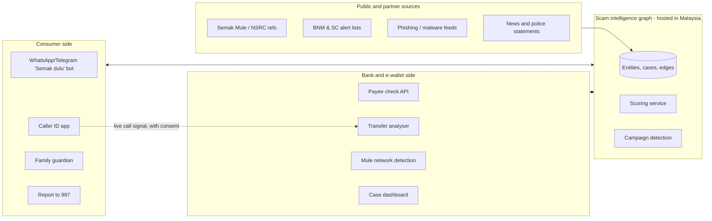
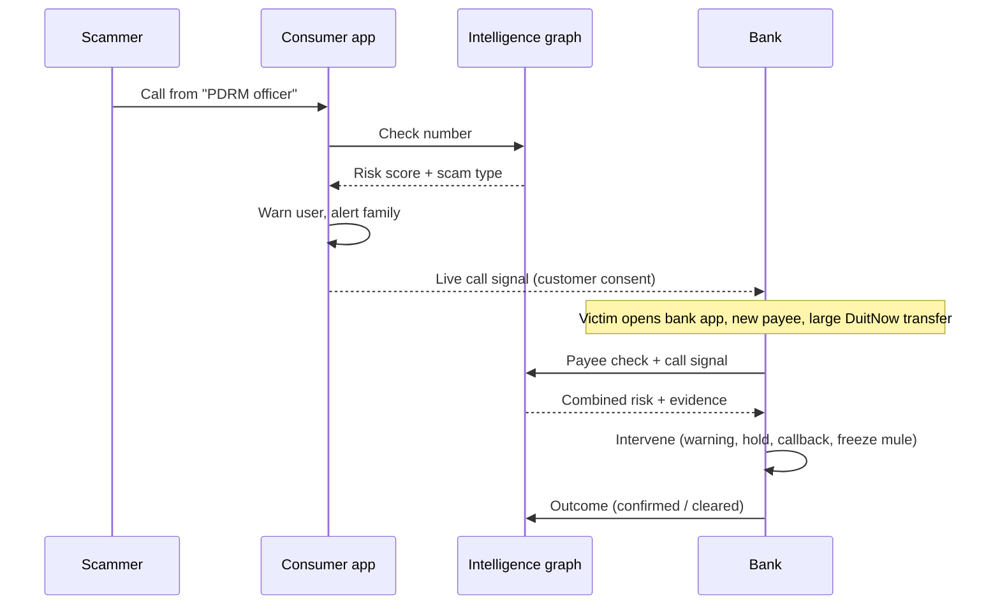
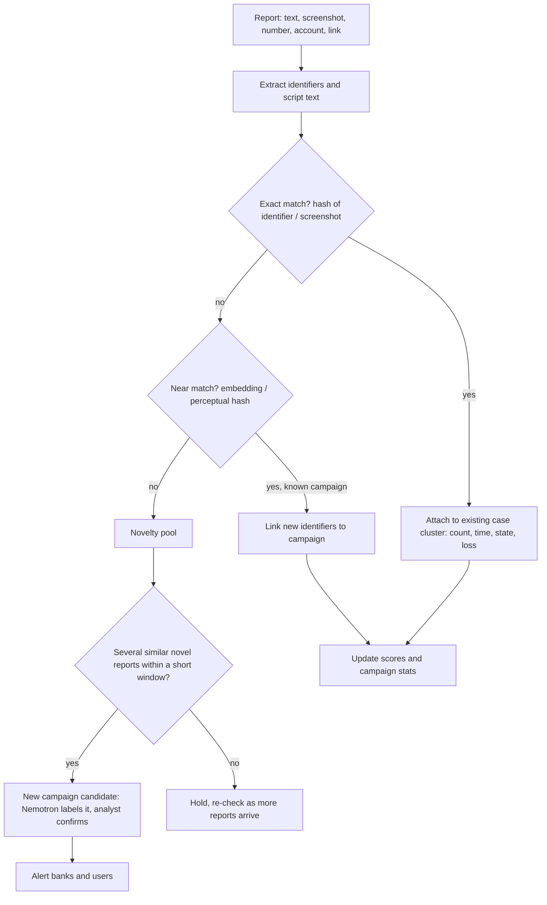

# CrowdShield: architecture (draft)

Status: draft, 20 Oct 2026. Product name: **CrowdShield** (pending MyIPO trademark, domain and app-store checks); consumer bot feature name "Semak dulu". Companion files: `schema.sql` (Postgres schema), `scoring.py` (reference risk scoring).

## 1. Purpose

A one-stop scam and fraud intelligence platform for Malaysia: one shared engine, three front doors.

- **Consumers** check calls, messages, links and accounts, get warned during scams, protect family members, and report quickly.
- **Business owners (SMEs)** verify suppliers, invoices and bank-detail changes before paying (SSM, MyInvois, account-name checks).
- **Banks and e-wallets** check payees before transfers, detect scam transfers, phishing-led account takeover and mule accounts, manage cases, and trace funds.

All three feed and query one **scam intelligence graph**. Each audience gets its own product surface; they share the data, scoring and case pipeline underneath. Each report, confirmed mule and intervention outcome makes the graph more accurate. That compounding data, plus the link between a live scam call and a bank transfer, is the differentiator.

### Malaysian context driving the design

- Most losses are authorised push payment scams: the real customer, on their own device, sends the money (Macau, investment, parcel, job and love scams).
- Scam calls are common. Telco spoof calls are being blocked at scale (MCMC's spoofing gateway blocked 101.66M spoof calls, Feb–Aug 2026), which is pushing scammers to WhatsApp calls.
- Existing assets: PDRM Semak Mule (public lookup, no known public API), NSRC 997, BNM/PayNet National Fraud Portal, BNM Financial Consumer Alert List, SC Investor Alert List. Whoscall partners with PDRM on caller ID.

## 2. System overview

## 3. Consumer side

| Component | What it does | Notes |
|---|---|---|
| **Semak dulu bot** (WhatsApp, Telegram) | User forwards a number, account, link or screenshot and gets a verdict in BM, English or Chinese | First build. Nemotron VL reads screenshots; identifiers are matched against the graph; the script is matched to known scam types |
| **Caller ID app** | Labels or blocks flagged numbers | Android: can screen calls before they ring. iOS: local block/label list only, no call audio |
| **Family guardian** | Alerts a family member when a protected person gets a flagged call or tries a risky transfer | Focus on elderly users |
| **One-tap report** | Builds the incident timeline and evidence pack, prompts the user to call NSRC 997 with a summary | Target: report within 15 minutes of discovery |
| **On-device classifier** (later) | Small model on the phone classifies messages and transcripts by scam type | Trained on Nebius, runs on device (MLX / llama.cpp). Content never leaves the phone |

## 4. Bank and e-wallet side

Adapted from the Sentinel AI multi-agent design: deterministic tools, audit trail, policy versioning.

| Agent / component | Malaysian version |
|---|---|
| **Payee check API** | Real-time risk score for a payee account before DuitNow/IBG/e-wallet transfers, with evidence and recency |
| **Scam-transfer analyser** | Sender-side signals: first transfer to a new payee, large amount soon after a limit increase, repeated transfers to one new payee, unusual hours, recent remote-access or sideloaded app |
| **Coaching detector** | Signs the customer is acting under instruction: hesitation, copy-pasted account numbers, failed attempts, new device binding, active call (via app SDK) |
| **Mule analyser** | Receiver side: new accounts with many small deposits from unrelated senders and fast pass-through; network mapping |
| **Scam-type classifier** | Maps the case to known Malaysian scam types to pick the right response |
| **Intervention engine** | Graded response: scam-specific warning in BM/EN/ZH/TA, cooling-off hold, callback, freeze of the receiving account, NSRC/NFP report |
| **Case dashboard** | Case management with BM/English case notes, evidence pack and audit trail |

First customers: digital banks, e-wallets, Islamic and co-operative banks, remittance and P2P/BNPL platforms. Large banks already run enterprise fraud tools.

### Bank fraud types beyond consumer scams

Consumer reports cover scams where the customer is tricked into paying. Banks also face fraud where the customer is not involved at all, detected mostly from the bank's own data.

| Fraud type | How it happens | Bank-side signals | Shared graph contribution | Scope |
|---|---|---|---|---|
| **Phishing to account takeover** | Fake bank site or SMS/WhatsApp link steals login and OTP; often a real-time proxy phishing kit | Login from new device/IP/ASN right after a phishing wave; impossible session patterns; new device binding then fast transfers; login referrer or timing matching a known phishing kit | Phishing URLs and domains reported by users; campaign timing | **In scope (core)** |
| **Brand impersonation** | Look-alike domains, fake apps, fake social pages and ads using the bank's name | Not visible in bank data | New-domain and certificate-log monitoring, screenshot comparison against the real bank site, takedown queue | **In scope (core)** |
| **Malware (APK) takeover** | Sideloaded APK abuses accessibility/SMS permissions, overlays the banking app, reads OTPs, remote-controls the phone | Mobile SDK: accessibility services on, overlay detected, remote-access app running, app installed from unknown source | APK hashes, package names, distribution links | **In scope** (needs SDK in the client app) |
| **SIM swap / number takeover** | Scammer takes over the victim's number to receive OTPs | Recent SIM change (telco API), new device + password reset + transfer in one session | Numbers involved in takeovers | Later (needs telco data) |
| **Mule accounts** | Accounts opened or rented to receive and pass on scam money | Many inbound transfers from unrelated senders, fast outflow, cash-out pattern | Confirmed mules, money trails, device reuse across banks (hashed) | **In scope (core)** |
| **Onboarding / application fraud** | Fake or stolen identities, edited IC images, deepfake selfie for eKYC, synthetic identities for loans or BNPL | Document tampering, face/liveness mismatch, same device or selfie across many applications | Hashed device and document fingerprints seen in fraud | Later |
| **Corporate payment fraud (BEC)** | Fake supplier bank-detail change for business customers | New payee on corporate account matching an invoice; supplier name vs account holder mismatch | MyInvois supplier verification (TIN, history) | Later, differentiator |
| **Card fraud (CNP, skimming)** | Stolen card details used online or cloned | Card authorisation data | Little | **Out of scope** (card networks and incumbents) |
| **Full AML / sanctions screening** | Structuring, layering, sanctions | Full transaction monitoring | Mule data only | **Out of scope** (regulated, crowded) |

### Bank-side detection modules

- **Phishing and brand monitor** (works before any customer is hit): new domain registrations and certificate-transparency logs filtered for bank-name look-alikes; Nemotron VL compares page screenshots against the real bank's login page; confirmed sites go to a takedown queue (registrar, hosting, MCMC) and into the graph so users and other banks are warned.
- **Account-takeover detector:** login and session risk scoring from device, IP, ASN, behaviour and timing; raises risk when a login follows a live phishing campaign targeting that bank; step-up authentication or block on high risk. Builds on BNM's existing measures (secure device binding, cooling-off for new devices, customer kill switch).
- **Device and malware risk:** lightweight SDK in the bank or e-wallet app reports risky device state; known APK hashes from the graph trigger a block and a customer warning.
- **Mule and money-flow analysis:** as in the agent table above, plus cross-bank device and mule intelligence shared as hashes.

### Data boundaries

- Each bank's raw data (logins, sessions, transactions, KYC) stays in its own isolated tenant or in the bank's environment. Models can be trained per bank; shared models are trained only on shared, de-identified features.
- Only these are shared through the graph: confirmed bad identifiers (hashed), phishing domains and URLs, APK hashes, hashed device fingerprints seen in confirmed fraud, campaign metadata.
- Every shared item carries its source and confidence, so banks can set their own thresholds.

## 5. SME side: fake supplier detection ("Semak supplier")

For small businesses buying from suppliers online (Facebook/WhatsApp sellers, marketplaces, B2B importers, existing suppliers by email).

### Threats

| Threat | Typical pattern |
|---|---|
| **Fake supplier** | Seller that doesn't exist: stock offered below market (gloves, palm oil, electronics, building materials), deposit or full payment upfront, goods never arrive |
| **Impersonated real supplier (BEC)** | Supplier's email hacked or spoofed; "we changed bank, please pay the new account"; urgent tone |
| **Fake invoice** | Invoice for goods never ordered, or a real invoice altered with a new bank account |
| **Fake buyer** (reverse case) | Fake transfer receipt, overpayment then refund request, buyer collects goods before payment clears |

### Checks

| Check | What it verifies | Source | Notes |
|---|---|---|---|
| Company registration | Exists, status active, registration date, directors, address | SSM (e-Info / SSM search) | Newly registered company selling large volumes = risk. SSM access is paid per search; API terms to confirm |
| Tax ID (TIN) | TIN is valid and matches the company | LHDN MyInvois TIN validation | Requires taxpayer or intermediary credentials; to confirm |
| E-invoice authenticity | Invoice was actually validated by LHDN (UUID / QR) | MyInvois | A fake or altered invoice won't validate. Strongest check for larger suppliers |
| Account holder name | Bank account belongs to the company, not an individual | DuitNow name enquiry (via bank partner payee check) | Company invoice paid to a personal account = high risk |
| Account reputation | Account, phone, email domain not linked to scams or mules | Scam intelligence graph, Semak Mule | Shared with consumer and bank sides |
| Supplier history | Same TIN and bank account as previous invoices | Business's own MyInvois received invoices and accounting records | New bank account for a known supplier = flag and callback |
| Email and domain | Domain age, look-alike of real supplier domain, SPF/DKIM/DMARC result, reply-to mismatch | WHOIS, email headers | Gmail/Outlook add-in |
| Document comparison | Invoice layout, wording and bank details vs previous invoices from this supplier | Nemotron VL | Catches altered templates |
| Seller signals | Page/account age, reused product photos, price far below market | Reverse image search, marketplace data | For social/marketplace sellers |

### Flow

1. Business forwards an invoice, email or seller chat (WhatsApp bot, email add-in, or accounting-software plug-in).
2. Nemotron extracts supplier name, SSM no., TIN, bank account, amounts, and flags urgency or bank-change language.
3. Checks above run in parallel; result is a risk level with the reasons, in BM or English.
4. On any bank-detail change: hold payment, call the supplier on a number from previous records (never the one in the email), confirm in writing.
5. For new suppliers above a threshold: suggest staged payment, escrow or payment on delivery.
6. Confirmed fakes go into the graph (accounts, domains, phones, company names) to protect other businesses and banks.

### Integrations

- Popular Malaysian accounting software (e.g. SQL Account, AutoCount, Bukku, Xero) for supplier master data and payment runs.
- Gmail / Outlook add-in for bank-change and invoice emails.
- Bank partners' payee check for account-name matching at payment time.
- MyInvois for TIN and e-invoice validation (see API notes below).

### API options (checked 20 Oct 2026)

| Need | API | Access model | Notes |
|---|---|---|---|
| Validate supplier TIN | MyInvois `GET /api/v1.0/taxpayer/validate/{tin}?idType=BRN&idValue=…` | Business's own ERP credentials, or the platform as a registered **intermediary** with the business's permission | Returns 200 valid / 404 not found. Throttled per client ID; validate once at supplier setup and cache |
| Check a received e-invoice is genuine | MyInvois `GET /api/v1.0/documents/{uuid}/details` | Receiver (the business) or intermediary; receiver sees Valid / Cancelled documents only | Returns status, validation steps, `longId`. ~125 requests/min per client ID |
| Supplier history | MyInvois Get Recent Documents / Search Documents | Same as above | Baseline of known suppliers' TINs and amounts |
| Quick check without credentials | Public validation link in the invoice QR code (`{portal}/{uuid}/share/{longId}`) | Anyone with the QR | Verify the link points to the official LHDN portal and details match; confirm whether automated fetching is permitted |
| Company registration (SSM) | SSM's own channels (MyData-SSM, SSM Search / SafeData-SSM, launched Aug 2024) | Paid, per document or data-supply agreement | Direct API terms to confirm with SSM |
| Company registration via aggregator | KYB providers, e.g. knowyourcustomer.com (live from MyData) | Commercial API | Name, type, reg. no., status, address, reg. date, directors, shareholders; ~30 SSM document types. Live lookups slow (median ~30 s) and not always available, so cache |
| Company credit and risk | CTOS, Experian Malaysia, RAM Credit Info | Commercial agreement | Credit reports, litigation, directors' other companies |
| Account holder name match | DuitNow account name enquiry | Only via bank / PayNet partners | Expose through the bank payee-check API |

Differentiator: the e-invoice and supplier-history checks are specific to Malaysia's mandatory e-invoicing and rely on SAP/ERP and MyInvois domain knowledge that foreign fraud vendors lack.

## 6. The call-to-transfer link (core differentiator)

The telco sees the call but not the transfer. The bank sees the transfer but not the call. Joining them, with consent, is what no single party can do.

## 7. Scam intelligence graph

Full DDL in `schema.sql` (Postgres 16 + pgcrypto + pgvector, 16 tables).

### Entities (nodes)

Phone, WhatsApp, Telegram, bank account, e-wallet, URL, domain, app (APK hash or package), social profile, crypto wallet.

- Normalised value (`+60…`, bank code + account number) stored as **HMAC-SHA256 lookup hash**.
- Raw value **encrypted**; decryption only for authorised investigators, always audit-logged.
- Public display is **masked** (`+60 12-***-4567`).
- `protected` flag for official numbers/accounts that scammers spoof (never listed as scam).

### Evidence model

- **scam_case**: one incident (source, scam type, loss, language, redacted narrative, verification level, campaign).
- **observation**: entity X played role Y in case Z (caller, payee account, link sent, app installed, impersonated official…).
- **edge** (derived): co-case, money flow (bank-supplied), same campaign, same device, redirects-to. Each edge has a propagation strength `alpha`.
- **script_snippet** + **campaign**: redacted scam text embedded (Qwen3-Embedding), clustered into campaigns; daily spike score per campaign.
- **entity_score**: precomputed scores for sub-50 ms lookups.
- **appeal** and **audit_log**.

### Sources and default weights (to be tuned on outcomes)

| Source | Weight |
|---|---|
| PDRM Semak Mule | 0.95 |
| Bank-confirmed mule | 0.90 |
| NSRC case reference | 0.85 |
| BNM / SC alert lists | 0.80 |
| Phishing and malware feeds | 0.60 |
| News and police statements | 0.50 |
| User report with evidence | 0.40 |
| User report, no evidence | 0.25 |
| Model inference | 0.00 (a lead, never evidence) |

## 8. Risk scoring

Reference implementation: `scoring.py`.

1. **Observation weight** = source weight × reporter trust (user reports only) × verification multiplier × recency decay.
   - Half-life by type: phone/WhatsApp 90 days (numbers get recycled), URL 30 days, bank account 365 days, app hash about 10 years.
2. **Direct probability**: noisy-OR across independent evidence. One vote per reporter and per suspected sybil cluster.
3. **Graph probability**: risk inherited from linked entities, `1 − Π(1 − alpha × p_neighbour)`. Online: one hop. Nightly GPU job (cuGraph): two hops across the full graph.
4. **Final risk** = `100 × (1 − (1 − p_direct)(1 − 0.8 × p_graph)) × clearing`. A clearing factor of 0.1 applies when the owner's appeal is upheld.
5. **Tiers**: no known risk (0, no evidence at all, never "safe"), reported (1–29), caution (30–59), high (60–84), confirmed (85+). Confidence (low/medium/high) is reported separately.

Worked examples:

| Situation | Risk | Tier |
|---|---|---|
| Two user reports only | 16 | Reported |
| + linked to a bank-confirmed mule account | 47 | Caution |
| + NSRC case reference | 99 | Confirmed |
| Same, owner appeal upheld | 10 | Reported |

### Safeguards

- User reports alone are capped at 59 (caution).
- Reporter trust starts at 0.3 and moves with upheld or rejected reports. Phone-verified reporters, rate limits, and holds on bursts from new accounts or the same device.
- Protected official numbers return: "Official number, may be spoofed: hang up and call back."
- Explanations show evidence counts, sources, scam types and last seen, never reporter identities.

## 9. Post-incident tracing

The platform can't locate scammers itself. Subscriber identity and phone location come from telcos via police powers. Its job is to capture evidence fast, follow the money, and hand police an actionable pack.

| Table | Purpose | Access |
|---|---|---|
| `incident_event` | Timestamped timeline of every step: first contact, hand-over between fake officers, links, app installs, transfers, call durations | Case parties |
| `scam_case` location fields | Victim state, district and age band, for hotspot analytics | Aggregated only |
| `fund_hop` | Money trail: victim → mule 1 → mule 2…, with amount, time, rail and amount frozen | Banks in the network, police |
| `cashout_event` | Where money left the system: ATM ID, branch, crypto exchange, overseas transfer, with state and time | Reporting bank and police only |
| `le_referral` | NSRC/PDRM report number, signed and hashed evidence pack, status, amount recovered | Platform, police |

### Flow after a successful scam

1. **0–15 min:** victim reports via app or bot. Timeline auto-built from screenshots and call log. Prompt to call NSRC 997 with a ready summary.
2. **Freeze and follow:** receiving account flagged to all banks in the network; onward hops recorded while funds can still be frozen.
3. **Stop the next victim:** mule accounts and numbers move to confirmed. Warnings go immediately to anyone else paying those accounts or getting calls from those numbers.
4. **Link cases:** matching scripts, numbers and accounts tie the case to its campaign or syndicate.
5. **Police hand-off:** evidence pack to PDRM CCID (timeline, money trail, cash-out points, linked cases).
6. **Learn:** recoveries, charges and closures feed back into scores and source trust.

### Out of scope by design

- Scammer hunting by the platform (tracking links to capture IPs, locating phone owners). Legal risk, evidence admissibility, and harm to innocent owners of spoofed numbers or recruited mules. Only under PDRM authority.
- Public display of precise locations of victims, mules or cash-outs.

### Alignment with NSRC (997)

NSRC is led by PDRM with BNM, MCMC and the National Anti-Financial Crime Centre, and has run 24/7 since March 2026. In 2025 it handled 146,167 complaint calls and froze 138,915 accounts. Speed of reporting decides how much can be frozen, so the platform's job is to get victims to 997 faster with better data, and to add what NSRC doesn't see.

**Data quality, built to NSRC's needs**

- Collect what tracing needs, in NSRC's terms: exact transaction time, amount, sender and receiver bank, receiving account, **transaction reference number**, scammer numbers and channel, scam category (mapped to PDRM categories).
- A pre-filled "997 call sheet" on screen while the victim calls, so the call is shorter and nothing is missed.
- Capture the NSRC reference and police report number back from the victim (`scam_case.nsrc_ref`, `police_report_no`); cases with these are upgraded from user report to NSRC-linked evidence.
- Evidence integrity: original files hashed and timestamped at upload; signed evidence pack with chain of custody.
- Explicit consent (`share_consent_at`) before anything is shared with NSRC or PDRM.

**What the platform adds that NSRC doesn't have**

- **Near-misses:** attempted scams with no loss (`near_miss`). Most people never call 997 if they didn't lose money, yet these reports reveal numbers, accounts and scripts before the next victim pays.
- **Early campaign detection:** new scripts and rotated identifiers spotted from report clusters, hours or days before they show up in loss reports.
- **Deduplicated, structured cases** in BM, English, Chinese and Tamil.
- **Hotspot and trend analytics** by state, age band, time and channel.
- **Public alert channel** (WhatsApp) to push NSRC/PDRM warnings to users.

**Partnership ladder**

| Level | Arrangement | Data flow |
|---|---|---|
| 0. User-mediated (day one) | No agreement needed | Platform prepares the report; victim calls 997 and enters the NSRC reference |
| 1. Recognised referral partner | MoU or letter with NSRC / PDRM CCID | Structured case submission with victim consent; acknowledgement and status back |
| 2. Intelligence exchange | Data-sharing agreement | Platform sends campaign alerts, near-miss identifiers, trend reports; receives confirmed numbers/mule accounts (e.g. Semak Mule feed) and case outcomes |
| 3. Through bank partners | Via member banks and the National Fraud Portal | Fund tracing and freezing stay inside the bank/NFP system; platform receives outcomes through bank partners |

Requirements for levels 1–2: Malaysian data hosting, PDPA-compliant consent and minimisation, security assessment, audit logging, and a track record (e.g. published monthly scam trend reports) to build credibility.

## 10. Duplicate reports and new-scam mining

Most reports will describe scams already known. Duplicates are treated as signal (volume, spread, rotation of identifiers), not stored as noise, and only genuinely new content goes to the expensive models.

### Pipeline

| Stage | Method | Cost |
|---|---|---|
| Exact duplicate | Keyed hash of normalised identifiers; perceptual hash (pHash) of screenshots; hash of normalised message text | Near zero, no model call |
| Near duplicate | MinHash on text; Qwen3-Embedding similarity against campaign centroids (pgvector) | Cheap |
| Extraction for new content | Nemotron VL / Super, batched | Only for reports that aren't exact duplicates |
| New campaign detection | Density clustering (HDBSCAN) of the novelty pool, nightly plus a rolling 6-hour window | GPU batch job |
| Labelling | Nemotron writes campaign summary, scam type, key phrases, BM/EN warning draft; analyst approves | Per new cluster |

### What "new" means

- **New identifier, known script:** scammers rotated their number or mule account. Auto-linked to the campaign; inherits campaign risk via graph edges. This is the most common case and the most valuable to catch quickly.
- **Known identifier, new script:** same syndicate trying a new story.
- **New script cluster:** a new scam type or variant (e.g. a new "LHDN refund" angle). Flagged when similar novel reports pass a volume threshold.
- **New channel or target:** known script appearing on a new platform, region or age group.
- **Drift:** a campaign's wording changes over time; tracked so detection keeps up.

### Consumer experience for known scams

- Instant answer when a match is found: "Known scam: fake parcel call, reported 214 times this week."
- One tap to add their own report without retyping. Only the new parts are asked for (number that called them, account they were given, time, state, any loss).
- Every report still counts towards volume and spread, under the one-vote-per-reporter rule.

### Outputs

- Per campaign: report volume, new identifiers per day, states affected, age bands, total reported loss, spike score.
- Early-warning feed to banks and e-wallets; weekly public "scams this week" bulletin.

## 11. Where Nebius fits

| Use | Nebius component |
|---|---|
| Extract cases from Malaysian news and police statements (seed data) | Token Factory batch inference, Nemotron Super; Tavily for discovery. About US$3 per 10,000 articles |
| Read user screenshots, receipts, fake IDs | Nemotron VL |
| Transcribe scam calls and voice notes (BM/EN/ZH) | GPU speech-to-text (Whisper / NVIDIA Parakeet) |
| Cluster script variants into campaigns | Qwen3-Embedding |
| Synthetic Malaysian transaction and scam data for testing | Nemotron generation (internal only, dual-use) |
| Scam-type classifier | LoRA fine-tune of Nemotron Nano; distilled for on-device use |
| Mule network detection, two-hop risk propagation | GPU graph analytics (cuGraph / GNN) |
| Warnings, case notes, NSRC/NFP reports, customer letters | Nemotron Super / Ultra |

**Not on Nebius:** the inline payment decision (needs low latency; graph lookup plus a small model near the bank) and the personal-data store (Malaysian hosting). Only redacted text, hashed identifiers and public content go to Nebius. Token Factory zero data retention enabled.

## 12. Privacy, legal and compliance

- **PDPA:** phone and account numbers are personal data. Keyed hashes, encryption, masking, purpose limitation, audit logging. Cross-border transfer rules under the amended PDPA need legal review before production.
- **Defamation and false listing:** evidence thresholds, confidence scores, appeal process, no bulk public list.
- **Bank requirements:** data residency, security review, SOC 2-style evidence, policy versioning on every decision. Map controls to BNM RMiT.
- **Dual-use:** synthetic scam scripts stay internal; no public export.

## 13. Data partnerships needed

| Partner | What it unlocks |
|---|---|
| PDRM CCID / Semak Mule | Authoritative confirmed numbers and accounts; police hand-off channel |
| NSRC | Case references, faster reporting |
| Banks, e-wallets (via National Fraud Portal where possible) | Confirmed mules, money trails, cash-out data, outcome feedback |
| Telcos / MCMC | Number status, terminated lines |
| LHDN (later) | MyInvois supplier verification for business-payment fraud |

## 14. Risks

- **Cold start:** seed from public sources and news; prioritise the PDRM partnership.
- **Data poisoning:** trust-weighted reports, sybil detection, caps on user-only evidence.
- **Overlap with the National Fraud Portal:** position as a complement (consumer signals, e-wallets, businesses), not a replacement.
- **Competition:** Whoscall and Truecaller on caller ID. Compete on the bank link, WhatsApp-first design and local script intelligence.
- **iOS limits:** no call audio; rely on number labelling and the bot.
- **Slow bank procurement:** start with digital banks and e-wallets.

## 15. Build order

1. Intelligence graph + seed pipeline (news extraction, alert lists, feeds) + Semak dulu bot.
1a. Semak supplier for SMEs (invoice/email check via the same bot), using SSM, MyInvois and graph checks.
2. Payee check API + bank case dashboard.
3. Victim reporting flow and tracing tables (timeline, money trail, police hand-off).
4. Android caller ID + family guardian.
5. Call-to-transfer link, piloted with one e-wallet or digital bank.

## 16. Open questions

### Business and product
- Trademark, domain (.my / .com.my / .com) and app-store availability for CrowdShield.
- Business model: consumer free vs. family plan; SME subscription price; bank pricing per lookup vs. SaaS.
- Which audience launches first after the consumer bot: SMEs (Semak supplier) or a pilot bank/e-wallet.
- First pilot partner: which digital bank or e-wallet.

### Data access and partnerships
- PDRM CCID / Semak Mule: is a data feed or API possible, and on what terms.
- NSRC: route to a referral MoU (via PDRM CCID or the National Anti-Financial Crime Centre).
- MyInvois: registering as an intermediary; whether automated fetching of public QR validation pages is permitted.
- SSM: direct API terms vs. a KYB aggregator; cost per lookup.
- DuitNow account-name check: only via bank/PayNet partners; which partner.
- Telco data (SIM swap, terminated lines): MCMC or telco channel.

### Legal and compliance
- PDPA: cross-border transfer rules for anything sent to Nebius; consent wording; retention periods.
- Liability for false listings (defamation): evidence thresholds, appeal SLA, terms of use.
- Licensing: does any feature need BNM/MCMC approval or registration.
- Bank requirements: data residency, security assessment, SOC 2-style evidence, BNM RMiT mapping.

### Technical
- Malaysian hosting provider and region for the personal-data store; exact boundary of what goes to Nebius.
- Graph store at scale: Postgres + nightly GPU export, or add Neo4j.
- Scoring weights, half-lives and tier cut-offs: tune once real outcome data exists.
- Android caller ID first; iOS scope given no call-audio access.
- Mobile SDK for banks (device and malware risk): build vs. partner.
- Confirm BNM's current authentication rules (secure device binding, cooling-off, kill switch) that the ATO detector builds on.

### Design still to do
- Victim reporting bot conversation (BM/EN), including the 997 call sheet.
- Semak supplier flow for SMEs.
- Bank payee-check API contract and case dashboard.
- Seed data pipeline from Malaysian news and alert lists.
